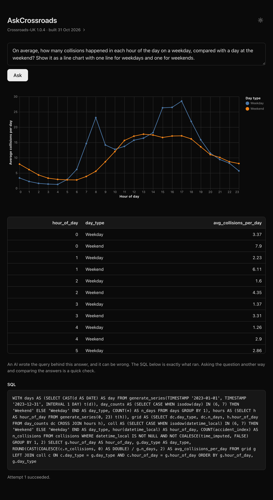
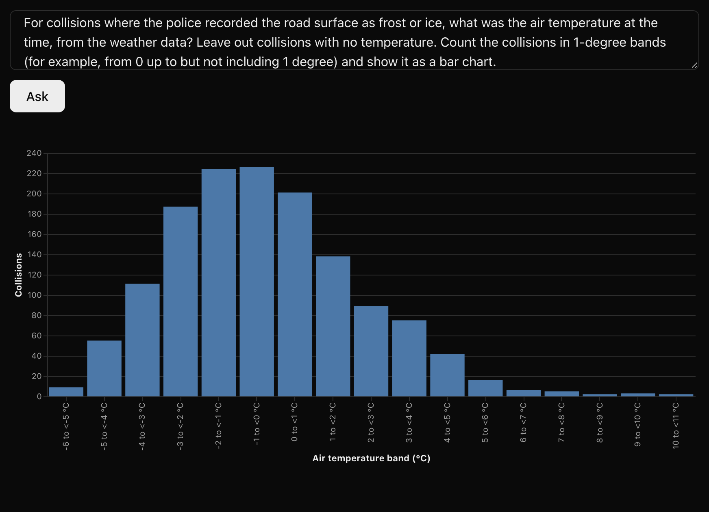
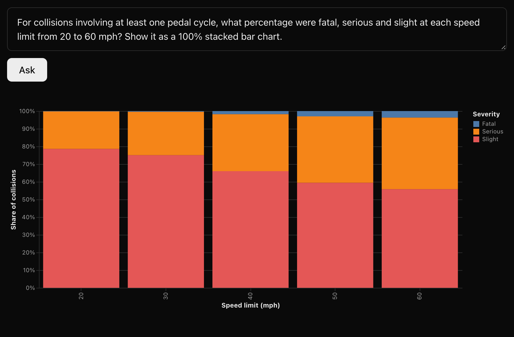
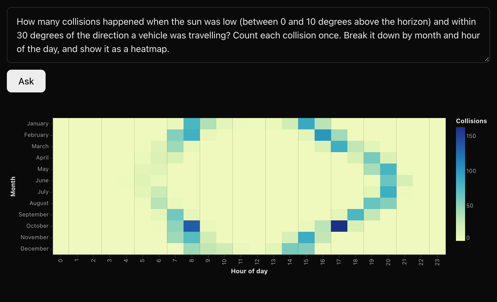
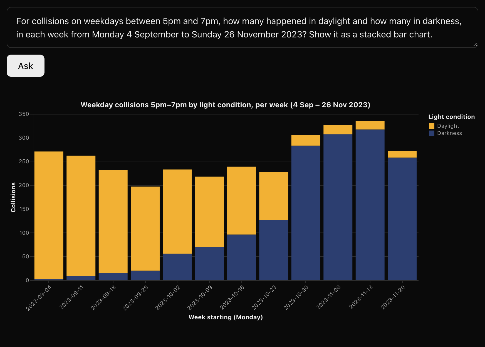
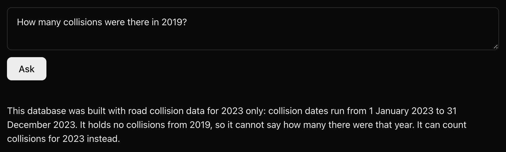

# AskCrossroads

[](https://github.com/wpatke/askcrossroads/actions/workflows/tests.yml)

Ask questions of UK public data (road collisions, weather, traffic counts and more) in plain
English and get back a chart, a data table, and the SQL that produced them. AskCrossroads
pairs an AI model with a [Crossroads-UK](https://github.com/wpatke/crossroads-uk) database to
make exploring the data and understanding what's in it easy, even for non-technical users.

In the screenshot below, the question is: "On average, how many collisions happened in each
hour of the day on a weekday, compared with a day at the weekend? Show it as a line chart with
one line for weekdays and one for weekends."

<p align="center">

</p>

## Why AskCrossroads?

UK public data is free and detailed, but in practice much of it is out of reach unless
you write SQL. AskCrossroads removes that barrier.

An AI model does the technical part. You type a question; the model writes a database query
(in SQL); the query runs against your database; and you see the answer as a chart and a table.
The full SQL statement is also included so everything is reproducible.

It reads databases built by [Crossroads-UK](https://github.com/wpatke/crossroads-uk), which
downloads separate public datasets and joins them into a single local DuckDB file. Today
those are the Department for Transport's STATS19 road-collision records and traffic counts,
ERA5-Land weather, ONS boundaries and bank holidays. That is the crossroads in the name: it
is easy to explore questions that cross from one dataset to another, such as collisions by
air temperature or rainfall, or collisions on bank holidays.

Road safety is where it starts, not where it stops. When Crossroads-UK adds a dataset,
AskCrossroads is designed to answer questions about it too.

Nothing is hosted. The database never leaves your computer. What is sent to the AI model
(Anthropic's Claude, through its API) is your question, the database's schema and codebook
(the table of what each code means), and, for charting, the result's column names and a
handful of sample rows.

## What it looks like

Every example below was asked of the same 2023 Crossroads-UK build. Each number was checked
against SQL written by hand, and each question was asked twice with identical results.

**Ice on the road, against the air temperature.** The police record the road surface; the
ERA5-Land weather data gives the air temperature at that place and hour. The two sources
agree: of the 1,391 frost or ice collisions with a temperature, 83% happened below 2°C,
peaking between −2 and 0°C (the median for all collisions is 11.6°C). The few above 5°C are
plausible: ice lingers, and the temperature is a grid-square average, not a roadside reading.



**Cyclist collisions by speed limit.** The share of collisions involving a pedal cycle in
which someone was killed or seriously injured roughly doubles, from 21% at 20 mph to 44% at
60 mph. Each collision is counted once. 70 mph is left out because it has only 50 collisions.



**Sun glare.** 2,577 collisions happened with the sun low in the sky (0 to 10 degrees above
the horizon) and within 30 degrees of a vehicle's direction of travel. The colour sits on
winter mornings and late afternoons and moves to around 8pm in summer; the busiest cells are
October at 5pm and 8am. These are counts, not risk: part of the pattern is low sun lining up
with rush hour. This builds on
[Example 2 in the Crossroads-UK README](https://github.com/wpatke/crossroads-uk#example-2-questions-the-raw-data-cant-answer).



**The clocks going back.** Weekday collisions between 5pm and 7pm, split by daylight and
darkness, each week from September to November 2023. The clocks went back on 29 October. In
the week before, there were 228 such collisions, 127 of them in darkness; in the week after,
306, with 283 in darkness. This is one year of counts, with no traffic volumes to compare
against.



## Can you trust the answers?

There are two separate questions here.

**Is the data right?** That is Crossroads-UK's job. How it downloads, joins, converts and
quality-flags the source data is described in its
[methodology](https://github.com/wpatke/crossroads-uk/blob/main/docs/methodology.md), which
the app links to from the build details at the top of the page.

**Is the query right?** That is AskCrossroads' job, and this is what it does about it:

- **The connection is read-only.** The database is opened read-only, with file and network
  access switched off, so no query can change your data or reach outside the file.
- **Only a single `SELECT` is run.** Every query, including each retry, is checked by
  DuckDB's own parser before it runs. Anything else is refused.
- **It declines instead of guessing.** If the database cannot answer a question, for
  example a year it does not cover, it says so in plain English rather than returning an
  empty table that looks like an answer.

  

- **It never retries an empty result.** A query that fails with an error is retried, up to
  three attempts in all. A query that runs and returns no rows is never retried: retrying
  would push the model to loosen the query until something appeared, which would invent a
  result the data does not support.
- **The SQL is always shown,** along with every attempt that failed and why, so anyone can
  check exactly what ran.
- **An AI note sits under every answer,** saying that an AI wrote the query, that it can be
  wrong, and that asking the question another way and comparing is a quick check.
- **A hand-worked answer set** in [tests/integration/answers.yaml](tests/integration/answers.yaml)
  holds 16 questions whose answers were worked out by hand in SQL against a pinned
  Crossroads-UK build. The integration suite asks each one the ordinary way and checks the
  numbers that come back.

AskCrossroads is most helpful as an exploratory tool. The AI's SQL can be wrong, so treat its
answers as a starting point. Before citing a figure, check the SQL it shows, then cite that
query along with the build details shown at the top of the page (the database's
`crossroads_meta` stamp) so others can reproduce it.

## Install from source

AskCrossroads is not yet published on PyPI. It needs Python 3.11 or newer.

```bash
git clone https://github.com/wpatke/askcrossroads.git
cd askcrossroads
python3 -m venv .venv
source .venv/bin/activate        # on Windows: .venv\Scripts\activate
pip install -e .
```

### 1. Get a database

AskCrossroads reads Crossroads-UK databases and nothing else. Install Crossroads-UK and run
its wizard, which asks which datasets and years to build and where to save the file:

```bash
pip install crossroads-uk
```

```bash
crossroads
```

For the ERA5-Land weather data, install `"crossroads-uk[weather]"` instead; it needs a free
Copernicus CDS API key, and the build prints the setup steps. See the
[Crossroads-UK README](https://github.com/wpatke/crossroads-uk) for the details. The examples
above were made with Crossroads-UK 1.0.4, for 2023, with the `stats19`, `era5_weather`,
`aadf` and `bank_holidays` datasets and snapshot boundaries.

### 2. Configure

Copy the example settings file:

```bash
cp .env.example .env              # on Windows: copy .env.example .env
```

Then edit `.env`:

- `ANTHROPIC_API_KEY`: your Anthropic API key.
- `ASKCROSSROADS_DB`: the path to the database you built.
- `ASKCROSSROADS_PORT` (optional): the port to use, if something else already has 8000.

`.env` is gitignored, and is read from the directory you run `askcrossroads` from. Variables
set in your environment take priority over it. The key is held in memory for the session
only: AskCrossroads never writes it to disk, logs it, or sends it to the browser.

### 3. Run

```bash
askcrossroads
```

It checks the database, then opens http://127.0.0.1:8000 in your browser. Use
`askcrossroads --no-browser` to print the address without opening it, and Ctrl+C to stop. It
listens on your own machine only, not on your network. If the file is not a Crossroads-UK
database, it stops with a message saying how to build one.

### What it costs

Questions are answered by Claude Opus 5.5, through the Anthropic API, on your own API
account. A question usually takes **two model calls**: one to write the SQL, then one to
choose the chart. A query that fails with an error is sent back for repair, up to three
attempts for each call, so the most a single question can take is **six calls**. A declined
question, or one whose answer is empty, usually takes just one, because there is nothing to
chart.

The SQL call includes the database's whole schema and codebook, around 40,000 tokens on a
national build. That part is cached, so a question asked within a few minutes of the last
reads it back at about a tenth of the normal input price. Check Anthropic's current pricing
for what that comes to.

## What v1 doesn't do

These are left out on purpose, not by oversight:

- **Crossroads-UK databases only.** It is not a general tool for asking questions of any
  database. It reads the tables, and what their codes mean, from the database itself rather
  than having them built in, so a new Crossroads-UK dataset needs no change to AskCrossroads'
  own code.
- **No curated example questions.** Examples written in advance would assume datasets and
  years that your build may not have.
- **One database per run.** Switching to another database means editing `.env` and
  restarting.
- **One question at a time.** A second question while one is running is refused, not
  queued.
- **Anthropic only.** There is no setting for another model provider.
- **Up to 5,000 rows are shown.** A larger result is cut off, with a notice saying so, and
  the chart covers only the rows shown. The SQL is never rewritten to add a limit.
- **Not yet built:** query history, saving or exporting results, follow-up questions that
  refine the last one, sign-in, any hosted version, publication on PyPI, and example
  questions generated from the loaded build.

## Development

```bash
pip install -e ".[dev]"
python -m playwright install chromium   # one-time download for the browser tests
python -m pytest                        # fast, offline suite
python -m pytest -m integration         # real API calls against a real build (run deliberately)
```

The default suite needs no API key, no network and no real database: the model is replaced
by a local stand-in, and the databases are small ones built inside the tests. The browser
tests skip if Chromium is not installed.

The integration suite costs API credit. It reads the key the same way the app does, and
needs `ASKCROSSROADS_TEST_DB` pointing at a real Crossroads-UK build; without either, it
skips rather than fails. The answer set only runs against the pinned build, whose details
and build instructions are in
[tests/integration/live_fixtures.py](tests/integration/live_fixtures.py).

The full design is in **[docs/spec.md](docs/spec.md)**, and the implementation plans are in
[docs/plans/](docs/plans/).

## Licence & AI disclosure

AskCrossroads is released under the [MIT Licence](LICENSE). It is **not affiliated with or
endorsed by** the Department for Transport, the Office for National Statistics, Ordnance
Survey, Copernicus/ECMWF, or Anthropic. The data in a Crossroads-UK database comes from those
public sources, under their own licences; see Crossroads-UK's
[data sources](https://github.com/wpatke/crossroads-uk/blob/main/docs/data-sources.md) for
the attribution each one needs. AI usage in development is documented in
**[docs/ai-disclosure.md](docs/ai-disclosure.md)**.
